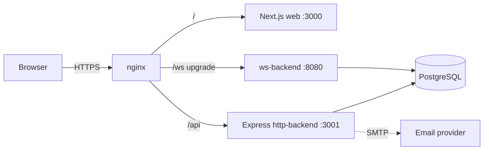
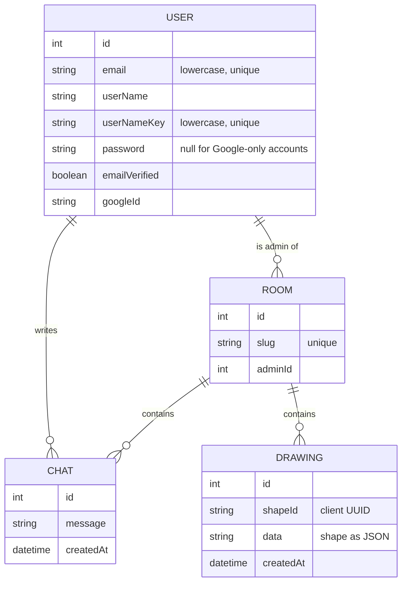

# weDraw

A real-time collaborative whiteboard with chat. Create a room, share its slug, and draw together on a canvas built from scratch with the browser's Canvas API, no drawing libraries.

**Live demo: [https://wedraw.duckdns.org](https://wedraw.duckdns.org/)**

[](https://github.com/piyush-atrish/weDraw/actions/workflows/ci-cd.yml)

> The demo runs on a small Azure VM that is switched off when not in use to save student credits, so the link may be unavailable. If it doesn't load, it is simply powered down.

<!-- Add a screenshot or GIF here once you have one:

-->

## Table of contents

- [Features](#features)
- [Tech stack](#tech-stack)
- [Architecture](#architecture)
- [How it works](#how-it-works)
- [Project structure](#project-structure)
- [Getting started](#getting-started)
- [Environment variables](#environment-variables)
- [Deployment and CI/CD](#deployment-and-cicd)
- [Design decisions](#design-decisions)
- [Known limitations and roadmap](#known-limitations-and-roadmap)

## Features

**Drawing**
- Seven tools: rectangle, circle, triangle, arrow, line, pencil and eraser
- Live preview while dragging; shapes become permanent when you release
- Smooth freehand strokes, sharp rendering on high-DPI screens, resizes with the window
- Object eraser: shapes you sweep over fade, and are removed when you let go
- Everything syncs to other people in the room instantly, and is saved so it is still there when you rejoin

**Rooms and chat**
- Create a room with a unique slug, or join an existing one by slug
- Real-time chat with saved history (the latest 50 messages load on join) and usernames on messages
- Collapsible chat sidebar over a full-screen canvas, plus a live connection status indicator
- The room admin can delete a room: everyone inside is notified, and the room, its messages and its drawings are removed
- Idle rooms clean themselves up: an hourly job deletes rooms that nobody is in and that have had no chat or drawing for an hour

**Accounts**
- Sign up with email and password, verified by a 6-digit code sent to your email
- Passwordless sign-in with an email code
- Sign in with Google
- Email and username are case-insensitive, so `Piyush` and `piyush` can't both exist
- Password rules that also reject passwords containing your username or the first part of your email

## Tech stack

| Layer | Technology |
|---|---|
| Frontend | Next.js 16 (App Router), React 19, TypeScript, Tailwind CSS 4, Axios |
| Canvas | Plain HTML5 Canvas 2D API and Pointer Events, no libraries |
| REST API | Node.js 24, Express 5, Zod |
| Realtime | `ws` WebSocket server |
| Database | PostgreSQL (Neon) with Prisma 7 |
| Auth | JWT in httpOnly cookies, bcrypt, Google Identity Services, Nodemailer (SMTP) |
| Monorepo | Turborepo and pnpm workspaces |
| Infrastructure | Azure VM (Ubuntu 24.04), nginx, Let's Encrypt, PM2, DuckDNS |
| CI/CD | GitHub Actions deploying over SSH |

## Architecture

The browser only ever talks to one origin. nginx routes by path, which keeps cookies simple and avoids CORS in production.



Data model:



A separate `EmailOtp` table holds the hashed one-time codes.

## How it works

### Authentication
- **Sessions:** a JWT in an `httpOnly`, `SameSite=Lax` cookie (`Secure` in production) that expires after one day. JavaScript never sees the token; the frontend asks `/me` who it is.
- **Email codes:** six digits, valid for 10 minutes, five attempts, one resend per minute. Only a keyed hash bound to the email is stored, comparison is constant-time, and a code can be used once even if two requests race.
- **Verification:** unverified accounts can't sign in. If someone registers with an email they don't own, signing in with an email code or Google wipes the password they set, so it can't be used to take over the real owner's account later.
- **Google sign-in:** the browser gets a signed ID token from Google, and the backend checks its signature, audience and `email_verified` claim before creating or linking an account.
- **Other protections:** bcrypt hashing, a dummy-hash comparison so unknown emails take as long as wrong passwords, generic answers on code requests (no account enumeration), and a limit of 10 auth requests per minute per IP.

### Realtime protocol
One WebSocket connection per tab. Messages are JSON, validated on the server with a Zod discriminated union.

| Client sends | Meaning |
|---|---|
| `join_room`, `leave_room` | Enter or leave a room |
| `chat` | Send a message |
| `draw` | A finished shape |
| `erase` | Delete shapes by id |
| `delete_room` | Delete the room (admin only) |

| Server sends | Meaning |
|---|---|
| `joined`, `left` | Acknowledgements |
| `drawings` | Full snapshot of the room's drawing, sent right after joining |
| `chat`, `draw`, `erase` | Live updates from other users |
| `room_deleted` | The room was removed |
| `error` | Something was rejected |

Details that matter:
- The socket authenticates with the same cookie as the REST API, and the server checks the `Origin` header to prevent cross-site WebSocket hijacking.
- Messages from one connection are processed strictly in order, so a quick draw followed by an erase can't be reordered at the database.
- A heartbeat drops dead connections, the payload size is capped, and the client reconnects with exponential backoff, rejoins, and re-syncs from a fresh snapshot.
- Live updates are applied by id, so repeated events can never duplicate a message or a shape.

### The canvas engine
A framework-independent `CanvasEngine` class draws the board:
- **pointerdown** records where you started. **pointermove** updates the current point and requests a frame, throttled to about 30 fps; each frame clears the canvas, redraws every permanent shape, and draws the in-progress shape on top. **pointerup** commits the shape into the permanent list.
- Shapes are plain serializable objects with a UUID, so syncing one is just sending JSON.
- Pointer Events with pointer capture work for mouse, touch and pen, and keep tracking when the cursor leaves the canvas.
- The eraser removes whole shapes, found with point-to-segment distance tests along the sweep path. This is what makes erasing simple to sync: "delete these ids".
- Drawing is disabled until the room is joined, so a shape can never exist locally without reaching the server.

### Persistence and cleanup
- Chats and drawings live in PostgreSQL. Drawings are stored as validated JSON with a unique `(roomId, shapeId)`, ordered by insertion so stacking order survives reloads.
- Deleting a room cascades to its chats and drawings at the database level.
- The WebSocket server knows who is connected, so it also runs the hourly cleanup of empty, idle rooms.

## Project structure

```
weDraw/
├── apps/
│   ├── web/                  Next.js frontend
│   │   └── app/
│   │       ├── (auth)/       sign-in and sign-up pages
│   │       ├── room/[roomId] the whiteboard page
│   │       ├── components/   canvas, chat, ui, room
│   │       ├── hooks/        useAuth, useSocket, useRoomChat, useDrawingSync
│   │       └── lib/          API client, socket types, canvas engine
│   ├── http-backend/         Express REST API
│   │   └── src/              routes, dao, services (otp, mailer, google), middlewares, validators
│   └── ws-backend/           WebSocket server
│       └── src/              handlers, RoomManager, auth, cleanup, types
├── packages/
│   ├── db/                   Prisma schema, migrations and client
│   ├── backend-packages/     shared JWT helpers
│   └── ui, eslint-config, typescript-config, tailwind-config
├── scripts/deploy.sh         the script the CD pipeline runs on the server
└── .github/workflows/        CI/CD
```

## Getting started

You need Node.js 24 or newer, pnpm 11, and a PostgreSQL database (a free [Neon](https://neon.com) project works well).

```bash
git clone https://github.com/piyush-atrish/weDraw.git
cd weDraw
pnpm install
```

Create the `.env` files described below, then apply the database migrations and start everything:

```bash
pnpm --filter @repo/db db:migrate
pnpm dev
```

| Service | URL |
|---|---|
| Web app | http://localhost:3000 |
| REST API | http://localhost:3001 |
| WebSocket server | ws://localhost:8080 |

Open the app at `http://localhost:3000` rather than `127.0.0.1`, because the WebSocket server only accepts connections from the configured origin. With no SMTP settings, email codes are printed in the http-backend's terminal, so you can try signup without sending real email.

Other useful commands:

```bash
pnpm build                          # build every app and package
pnpm lint                           # lint
pnpm check-types                    # type-check
pnpm --filter @repo/db db:generate  # regenerate the Prisma client
pnpm --filter @repo/db db:deploy    # apply migrations (what production runs)
```

## Environment variables

Each backend reads a `.env` file from its own folder.

| Variable | Where | Purpose |
|---|---|---|
| `DATABASE_URL` | http-backend, ws-backend, db | PostgreSQL connection string (use the pooled one in production) |
| `DIRECT_URL` | `packages/db` | Direct (non-pooled) connection string, used by Prisma migrations |
| `JWT_USER` | http-backend, ws-backend | Secret for signing and verifying sessions. **Must be identical in both** |
| `ALLOWED_ORIGIN` | ws-backend | The exact frontend origin allowed to open sockets, e.g. `http://localhost:3000` |
| `NODE_ENV` | http-backend | `production` makes the session cookie `Secure` |
| `SMTP_HOST`, `SMTP_PORT`, `SMTP_USER`, `SMTP_PASS`, `MAIL_FROM` | http-backend (optional) | Email delivery. If unset, codes are printed to the console |
| `GOOGLE_CLIENT_ID` | http-backend (optional) | Verifies Google sign-in tokens |
| `NEXT_PUBLIC_GOOGLE_CLIENT_ID` | web (optional, build time) | Shows the "Continue with Google" button |
| `ROOM_IDLE_MINUTES`, `CLEANUP_INTERVAL_MINUTES` | ws-backend (optional) | Tune the idle-room cleanup (both default to 60) |

`NEXT_PUBLIC_*` values are baked into the frontend when it is built, so change them and rebuild.

## Deployment and CI/CD

**Production setup**
- **Server:** an Azure VM (Ubuntu 24.04) with key-only SSH, a UFW firewall allowing only SSH, HTTP and HTTPS, a swap file for the small instance, automatic security updates, and log rotation.
- **Processes:** the three Node apps run under PM2, which restarts them if they crash and starts them again after a reboot.
- **Edge:** nginx terminates TLS (a free Let's Encrypt certificate that renews automatically) and routes `/` to the web app, `/api` to the REST API, and `/ws` to the WebSocket server, with the upgrade headers and long timeouts WebSockets need.
- **Domain:** a free DuckDNS subdomain pointing at a static public IP.
- **Database:** a dedicated Neon project for production, separate from the one used in development.

**CI/CD with GitHub Actions** (`.github/workflows/ci-cd.yml`)
1. **CI** runs on every push and pull request: install with a frozen lockfile and build every package, which also type-checks the code.
2. **CD** runs on pushes to `main`, after CI passes. It connects to the server over SSH with a dedicated key.
3. That key can run **one command only**: the server authorizes it with a forced command (`restrict,command=...`), so even a leaked key can't open a shell.
4. The server then fetches the latest `main`, installs, builds, applies database migrations, reloads the PM2 apps, and checks that they respond. If the health check fails, the run is marked failed.
5. Concurrent deploys are queued, and a lock on the server stops two from overlapping.

## Design decisions

- **One origin in production.** Free hosting subdomains are on the Public Suffix List, so browsers treat them as separate sites and would not share the login cookie with a separate WebSocket host. Serving everything from one domain through nginx avoids that, and removes the need for CORS.
- **Object eraser, not pixel eraser.** Syncing "delete these shape ids" is tiny and exact, while syncing painted-over pixels is not.
- **Shapes as data.** Because every shape is a JSON object with an id, drawing, saving, syncing and erasing all use the same format.
- **Subscribe before joining.** The client listens for the room snapshot before it joins, and the server sends the snapshot in the same step as the join, so updates can't arrive out of order.
- **Verified email as identity.** Every sign-in method ends in a verified email, which is what makes linking Google and password accounts safe.
- **Reproducible deploys.** The same script that deploys by hand is what the pipeline runs, so there is no separate "CI way" to drift out of sync.

## Known limitations and roadmap

**Limitations**
- Room state lives in the WebSocket server's memory, so it runs as a single instance. Scaling out would need a shared message bus such as Redis pub/sub.
- Erasing is permanent; there is no undo or redo yet.
- There is no password-reset page; signing in with an email code covers a forgotten password.
- The demo is hosted on student credits, so it is only online when needed.

**Planned**
- Text tool, colour and stroke width, undo and redo
- Live cursors for other participants
- Docker images built in CI, with one-step rollback
- Zero-downtime releases

---

Built by [Piyush](https://github.com/piyush-atrish).
